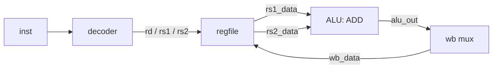
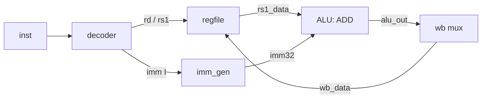
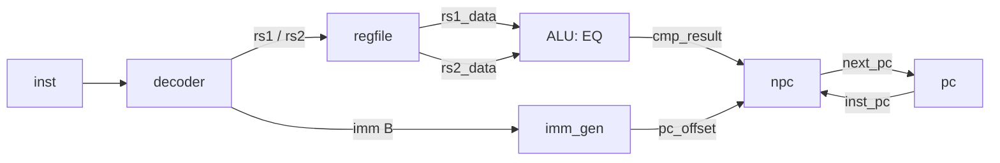
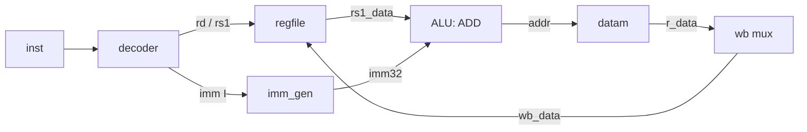
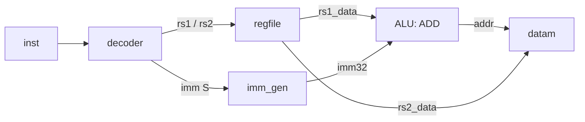
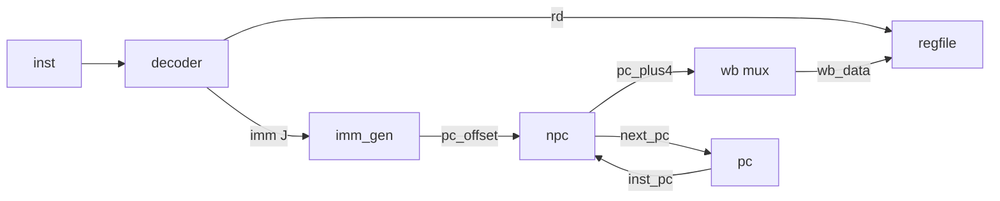
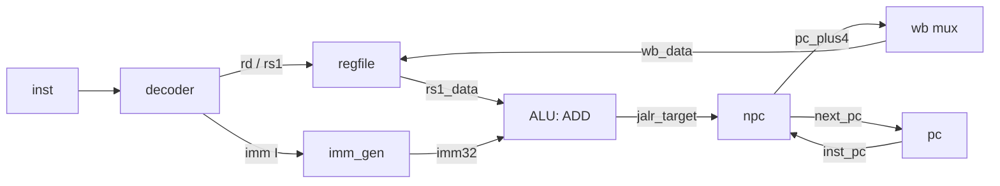

# v0.3-rv32i 单指令数据流

> 本文只画每条指令的**数据流**，控制信号（`ctrl`）省略，避免图太乱。
> 整体结构见 [datapath.drawio](datapath.drawio)，模块接口见 [units.md](units.md)。

## add

## addi

## beq

## lw

## sw

## jal

## jalr

## 非法指令

非法时 `ctrl` 同时关闭 `reg_write`、`mem_read`、`mem_write`，所以不会写寄存器或内存。

---

## 备注

- `add/addi` 的 ALU 结果是写回数据；
- `lw/sw/jalr` 的 ALU ADD 结果是地址/target；
- `beq` 的 ALU 只产生 `cmp_result`；
- `jal` 不经过 ALU，ALU 保持 `ALU_NOP`；
- `pc_plus4` 始终由 NPC 从 `inst_pc` 计算，用于 `jal/jalr` 的 link；
- 分支目标使用本条指令的 `inst_pc + pc_offset`，不是 IF 级最新 PC。
